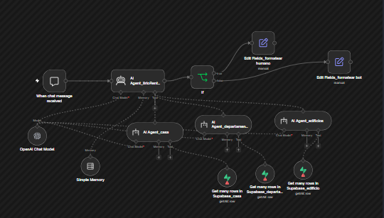

# 🏠 Agente IA de Rentas — Hogar y oficina a tu alcance

Sistema multiagente automatizado construido con **n8n** y **Supabase** para la **renta de casas, departamentos y edificios**.

## ✨ Características principales

* **Atención automatizada 24/7:** Responde consultas para uso residencial (hogar) y corporativo (oficina).
* **Arquitectura optimizada con subagentes:** Divide las consultas por tipo de propiedad (casas, departamentos y edificios) para ahorrar tokens y responder más rápido.
* **Base de datos en tiempo real:** Conectado a Supabase para consultar disponibilidad y características.

## 🧠 Arquitectura del Sistema Multiagente

Este repositorio contiene la evolución del sistema de atención automatizada para **Lirio Rentas**:

1. **`My_workflow.json` (Agente Clasificador Base):** Filtro inicial de alta velocidad diseñado con reglas estrictas de ahorro de tokens para identificar el tipo de inmueble (`casa`, `departamento` o `edificio`).
2. **`My_workflow_subagentes.json` (Arquitectura Multiagente):** Incorpora memoria conversacional y delega las consultas a subagentes especializados conectados a **Supabase**.
3. **`My_workflow_subagentescorregido.json` (Versión de Producción con Handoff Humano):** Añade enrutamiento condicional (`If`) para detectar cuándo un cliente solicita atención personalizada (`TRANSFERIR HUMANO`) y formatea la salida (`humano: true/false`) lista para integrarse con canales de mensajería.

## 🛠️ Herramientas utilizadas

* **n8n** (Orquestación del agente y subagentes)
* **Supabase** (Base de datos PostgreSQL)
* **OpenAI** (Modelo de lenguaje)
* 
## 🙏 Agradecimientos
Un agradecimiento especial a mi profesora **Ingrid Estupiñan** y a todo el equipo de **DAXUS LATAM** por su guía, enseñanza y apoyo en mi formación para desarrollar soluciones reales con Inteligencia Artificial y automatización.
